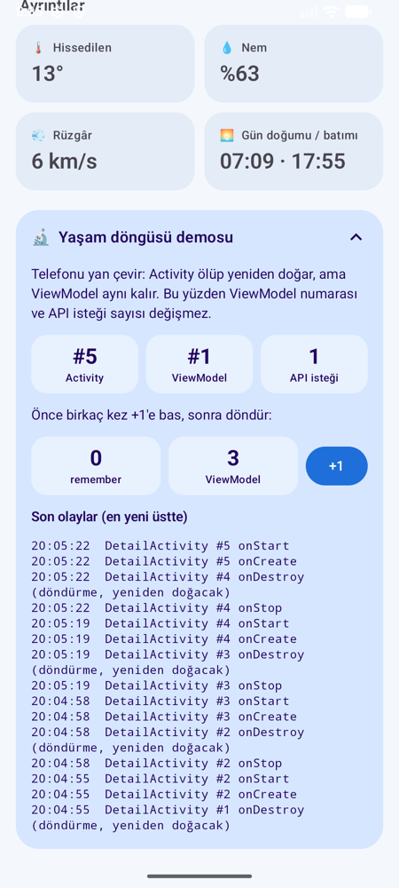
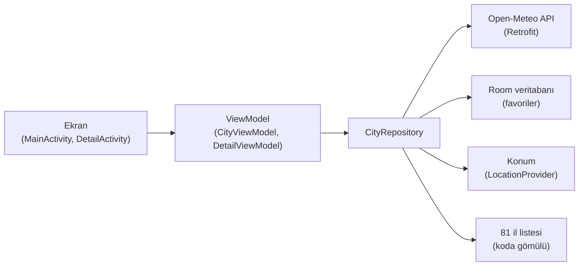

# 🌤️ Hava Durumu

Turkcell Bilişim Kampı (Android) için geliştirilmiş, Jetpack Compose ile yazılmış bir hava durumu uygulaması.
Şehir arayabilir, favorilerini kaydedebilir, bulunduğun yerin ve herhangi bir şehrin saatlik/günlük tahminini görebilirsin.

| Ana ekran | Arama | Şehir detayı | Yaşam döngüsü demosu |
|:-:|:-:|:-:|:-:|
|  |  |  |  |

## Özellikler

- **Yazdıkça arama**: 400 ms debounce ile; 1–2 harfte 81 il içinde (internetsiz), 3+ harfte tüm dünyada arar
- **Gerçek hava durumu**: Kartlar havaya ve gece/gündüze göre renk değiştirir
- **Tembel yükleme**: Bir kartın sıcaklığı ancak kart ekrana gelince istenir (LazyColumn + `LaunchedEffect`)
- **Şehir detayı**: 24 saatlik tahmin, dün/bugün/yarın kartları, önümüzdeki günler, nem/rüzgâr/hissedilen/gün doğumu
- **Favoriler**: Room veritabanında saklanır, uygulama kapanınca kaybolmaz
- **Konumum**: Çalışma anında konum izni istenir, reddedilirse Ayarlar'a yönlendirilir
- **Aşağı çekip yenileme**, iskelet (skeleton) yükleme animasyonu, hata ve "sonuç yok" ekranları
- **Açık / koyu tema**, kendi uygulama ikonu

## Kullanılan teknolojiler

| Konu | Kullanılan |
|---|---|
| Arayüz | Jetpack Compose, Material 3 |
| Mimari | MVVM + Repository |
| Ağ | Retrofit, Gson, OkHttp Logging Interceptor |
| Asenkron | Kotlin Coroutines, Flow |
| Veritabanı | Room (KSP) |
| Konum | LocationManager, Geocoder, Activity Result API (izinler) |
| Test | JUnit, kotlinx-coroutines-test, sahte (fake) sınıflar |
| Veri | [Open-Meteo](https://open-meteo.com/) (ücretsiz, API anahtarı gerektirmez) |

## Mimari



- **Ekran** sadece gösterir ve kullanıcının dokunuşlarını ViewModel'e iletir.
- **ViewModel** ekranın durumunu (`Loading / Success / Empty / Error`) tutar; ekran döndürülünce ölmez.
- **Repository** verinin nereden geleceğine karar verir. ViewModel internetten mi veritabanından mı geldiğini bilmez.
  Bu sayede testlerde gerçek API ve veritabanı yerine sahte sınıflar verilebiliyor.

## Yaşam döngüsü demosu

Detay ekranının en altındaki **🔬 Yaşam döngüsü demosu** kartı, Activity ile ViewModel'in farklı ömürlerini canlı gösterir:

1. Bir şehre dokun → `DetailActivity #1` ve `DetailViewModel #1` oluşur, API'ye **1** istek gider.
2. **+1**'e birkaç kez bas, sonra telefonu yan çevir.
3. Activity numarası artar (eski Activity öldü, yenisi doğdu), ama **ViewModel numarası ve API isteği sayısı aynı kalır**.
   `remember` ile tutulan sayaç 0'a döner, ViewModel'deki sayaç kaldığı yerden devam eder.
4. Geri tuşuna basınca `onDestroy (kapandı)` ve `DetailViewModel silindi (onCleared)` görünür.
   Detay açıkken arkadaki MainActivity ölmez, sadece `onStop` olur.

Aynı olaylar Logcat'te `tag:Yasam` filtresiyle de görülebilir.

## Çalıştırma

1. Projeyi Android Studio ile aç, Gradle senkronizasyonunun bitmesini bekle.
2. Bir emülatör ya da telefon seçip ▶️ Run'a bas (minSdk 24).

Testleri çalıştırmak için:

```bash
./gradlew testDebugUnitTest
```

## Proje yapısı

```
app/src/main/java/com/example/hava/
├── MainActivity.kt        Ana ekran: başlık, arama, konum kartı, favoriler, şehir listesi
├── DetailActivity.kt      Şehir detayı için ayrı Activity
├── DetailScreen.kt        Detay ekranının arayüzü + yaşam döngüsü paneli
├── CityViewModel.kt       Ana ekranın durumu (arama, favoriler, konum, yenileme)
├── DetailViewModel.kt     Detay ekranının durumu
├── CityRepository.kt      API, veritabanı ve konumu tek yerden yöneten katman
├── CityApi.kt / WeatherApi.kt / ApiClient.kt   Retrofit
├── AppDatabase.kt / FavoriteDao.kt / FavoriteCity.kt   Room
├── LocationProvider.kt    Telefonun konumu → şehir
├── LifecycleLog.kt        Activity/ViewModel olay günlüğü
└── ...                    Kartlar, durum ekranları, tema, hava kodları
```
